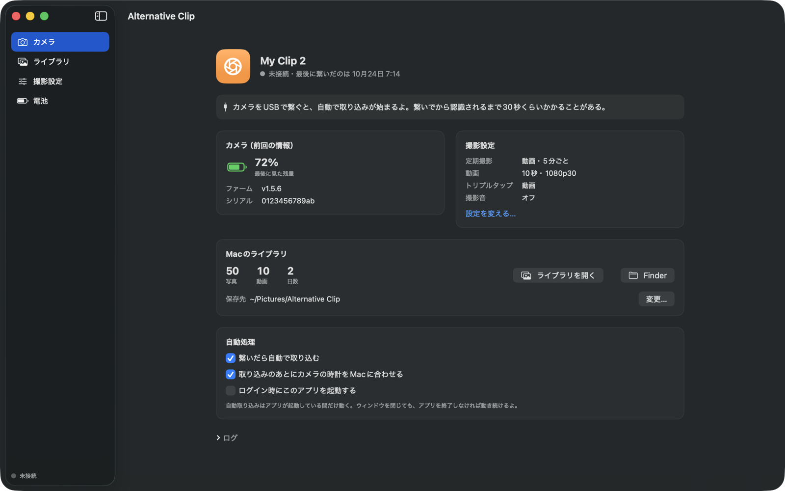
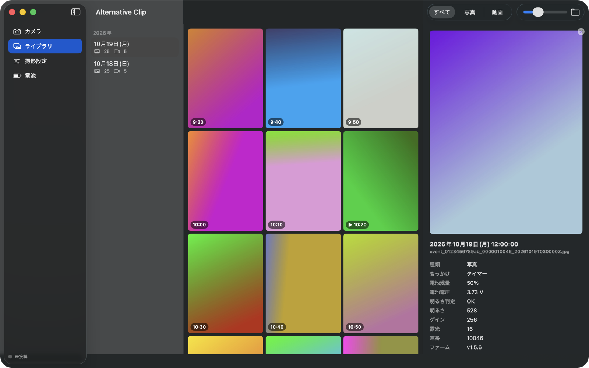
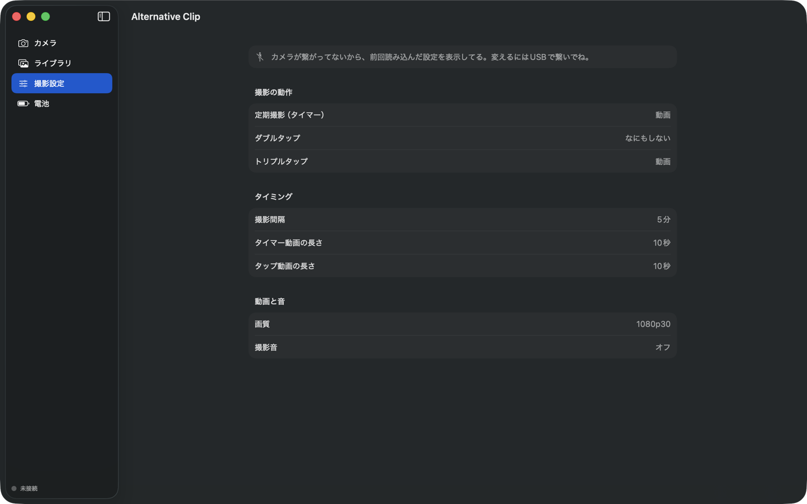
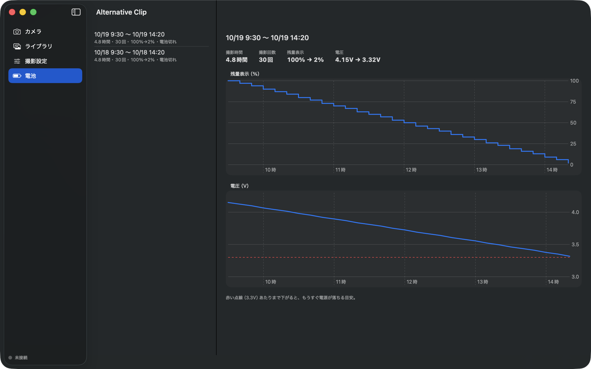

# Alternative Clip

**ライフログカメラ Narrative Clip 2 を、アカウントもクラウドも公式アプリもなしで使うための Mac アプリ。**

[English](README.md)

Narrative Clip を作っていた Narrative 社はもうなくて、公式のアップローダーも今の Mac では動きません。
Alternative Clip は USB で直接カメラと通信するので、写真や動画の取り込み、閲覧、撮影設定の変更、電池の状態の確認がまたできるようになります。

> **非公式アプリです。** Narrative AB とは関係ありません。「Narrative」「Narrative Clip」は各権利者の商標で、
> ここでは対応カメラを示すためだけに使っています。



## できること

- **取り込み**：カメラの中身を Mac のフォルダ（初期設定は `~/Pictures/Alternative Clip`、日付ごとのフォルダ）にコピー。取り込み済みのファイルは飛ばします。カメラを繋ぐと自動で始まります
- **照合**：カメラのファイルをもう一度読み直して、Mac のコピーと一致するか確認（SHA-256）
- **カメラを空ける**：バイト単位で一致を確認できたファイル**だけ**をカメラから削除
- **ライブラリ**：日付ごとのサムネイル、写真／動画の切り替え、動画の再生、撮影ごとのメタデータ
- **いらないものを削除**：ライブラリで選んでゴミ箱へ。カメラに残っているものも一緒に消します（繋がっていなければ次に繋いだとき）。消したものは二度と取り込みません
- **撮影設定**：タイマー・ダブルタップ・トリプルタップの動作（写真・動画・連写・なにもしない）、撮影間隔（10秒〜5分）、動画の長さ、画質（最高 1080p30）、撮影音。たとえば「5分ごとに10秒の動画を撮る」設定にもできます
- **電池**：撮影ごとにカメラが記録している残量と電圧から、満充電から電池切れまでの推移をグラフ表示
- **時計合わせ**：取り込みのあとにカメラの時計を Mac の時刻に合わせます
- ログイン時に起動、日本語と英語に対応（Mac の言語設定に合わせて切り替わります）

ファームウェアの書き換えと初期化は、あえて入れていません。

| ライブラリ | 撮影設定 | 電池 |
|---|---|---|
|  |  |  |

## 動作環境

- macOS 14 Sonoma 以降（Apple シリコン・Intel）
- **Narrative Clip 2**（USB `f0f0:cafe`）。ファームウェア v1.5.6 で動作確認
  初代 Narrative Clip（Clip 1、`f0f0:1337`）には**対応していません**。Clip 1 には
  [narrative-clip-sync](https://github.com/garykb8/narrative-clip-sync) や
  [NarrativeClip](https://github.com/chrisv-uk/NarrativeClip) があります

## インストール

1. [Releases](../../releases) から `AlternativeClip.zip` をダウンロードして展開し、**Alternative Clip.app** をアプリケーションフォルダに入れます
2. Apple の開発者署名がないので、最初は macOS にブロックされます。一度開こうとしてから、**システム設定 › プライバシーとセキュリティ** で **このまま開く** を押してください。ターミナルなら：

   ```bash
   xattr -dr com.apple.quarantine "/Applications/Alternative Clip.app"
   ```

3. カメラを USB で繋ぎます。認識されるまで 30 秒くらいかかることがあります

## ソースからビルド

Xcode（または動く Swift 5.9 以降のツールチェーン）が必要です。

```bash
git clone https://github.com/shokuan/alternative-clip.git
cd alternative-clip
scripts/build_app.sh --install   # build/Alternative Clip.app を作って ~/Applications にコピー
```

`scripts/build_app.sh --zip` で配布用の `build/AlternativeClip.zip` も作れます。

## コマンドラインツール

[`tools/clip2.py`](tools/clip2.py) で同じことをターミナルからできます（Python 3、`pip install pyusb`、`brew install libusb`）。

```bash
python3 tools/clip2.py info          # 電池・ファーム・時計
python3 tools/clip2.py pull          # 新しいファイルを取り込む
python3 tools/clip2.py verify        # カメラのファイルと Mac のコピーを照合
python3 tools/clip2.py actions       # タイマーやタップの動作を表示
python3 tools/clip2.py set-action timer RecordVideo
python3 tools/clip2.py set-interval 300
```

## 仕組み

Clip 2 は独自方式の USB デバイスで、命令はベンダー独自のコントロール転送、データはバルク転送で返ってきます。設定はカメラ内の D-Bus サービスにあって、USB 側からは番号付きのパラメータ・JSON のプロパティ・コマンドとして見えます。わかっていることは **[docs/PROTOCOL.md](docs/PROTOCOL.md)**（英語）にまとめてあります。

使っていてわかったこと：

- 電池が完全に切れると、カメラの時計が 2000-01-01 に戻ります。時計が合わせ直されるまでに撮ったものは「時計リセット中に撮影」にまとまります（順番はカメラの連番で正しく並びます）
- 古い電池だと残量表示は当てになりません。表示が 40% のまま電源が落ちることもあります。電池の画面では電圧も見られるので、そちらが目安になります
- 写真と動画はカメラにあるままコピーします。再圧縮はしません

## 安全のために

- カメラからファイルを消すのは2つの場合だけです：**カメラを空ける**（Mac のコピーとバイト単位で一致したファイルだけを消す）と、ライブラリで自分で削除したもの（確認のあと）
- ライブラリでの削除は Mac のファイルをゴミ箱に移すだけなので、元に戻せます。削除したものの一覧はライブラリのフォルダの `deleted.txt` にあって、行を消せばまた取り込めるようになります
- ファームウェアは書き換えません
- カメラが応答しなくなったら、USB のポートリセット（抜き差しと同じ）で立て直します。中のデータには触りません

自己責任で、バックアップを取ったうえで使ってください。

## クレジット

- プロトコル解析の先行研究：[chrisv-uk/NarrativeClip](https://github.com/chrisv-uk/NarrativeClip)、
  [garykb8/narrative-clip-sync](https://github.com/garykb8/narrative-clip-sync)、
  [mrquincle/memoto](https://github.com/mrquincle/memoto)

## ライセンス

[MIT](LICENSE)
