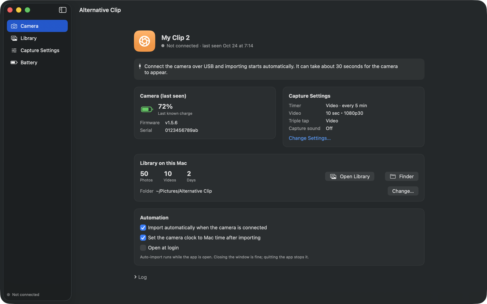
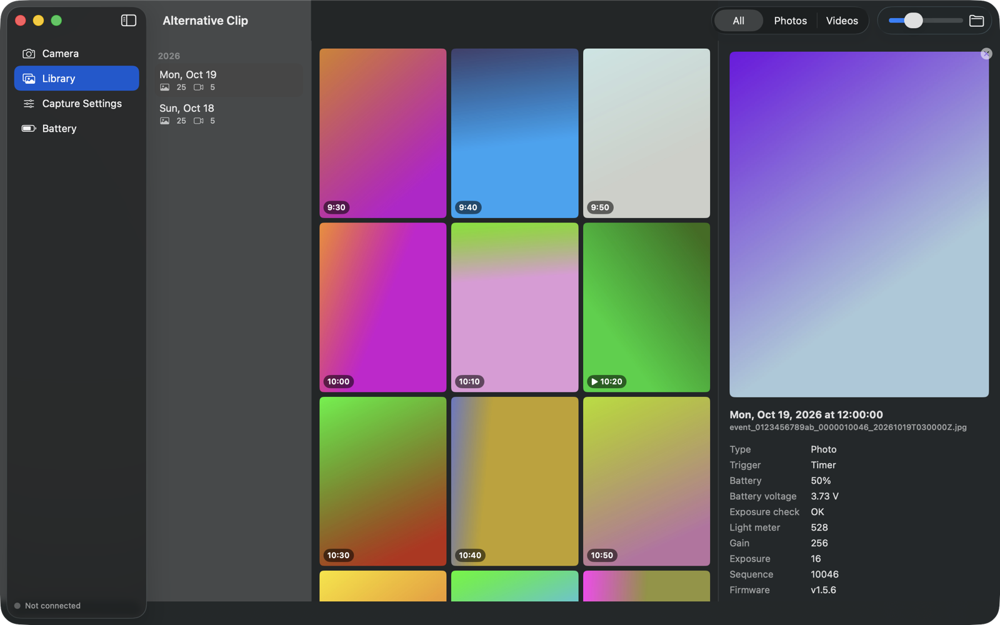
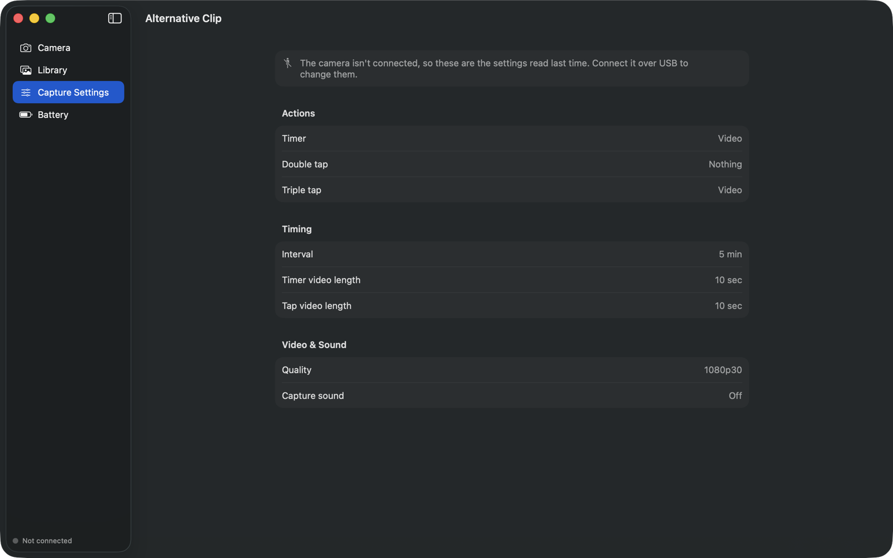
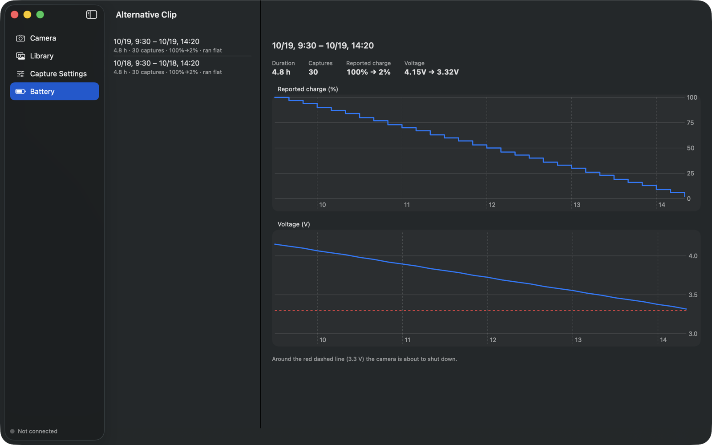

# Alternative Clip

**A Mac app for the Narrative Clip 2 lifelogging camera — no account, no cloud, no official uploader.**

[日本語の説明はこちら](README.ja.md)

Narrative, the company behind the Clip, shut down years ago, and its uploader doesn't run on current Macs.
Alternative Clip talks to the camera directly over USB, so you can keep using it: import photos and videos,
browse them, change capture settings and see how the battery is holding up.

> **Unofficial.** Not affiliated with or endorsed by Narrative AB. "Narrative" and "Narrative Clip" are trademarks
> of their respective owners and are used here only to say which camera this works with.



## Features

- **Import** everything from the camera into a folder on your Mac (default `~/Pictures/Alternative Clip`, one
  sub-folder per day). Already-imported files are skipped. Imports start automatically when the camera is plugged in.
- **Verify** — read every file from the camera again and compare it with the Mac copy (SHA-256).
- **Free up the camera** — delete files from the camera *only* after they've been verified byte for byte.
- **Library** — thumbnails by day, photo / video filter, video playback, per-capture metadata.
- **Delete what you don't want** — select captures in the library and move them to the Trash. Copies still on the
  camera are deleted too (right away, or the next time it's connected), and deleted captures are never imported again.
- **Capture settings** — what the timer, double tap and triple tap do (photo, video, burst, nothing),
  capture interval (10 s – 5 min), video length, video quality (up to 1080p30), capture sound.
  For example, the timer can record a 10-second video every 5 minutes instead of taking photos.
- **Battery** — charge and voltage over each discharge, from the data the camera stores with every capture.
- **Clock** — sets the camera clock to the Mac's time after each import.
- Open at login; English and Japanese.

Firmware updates and factory reset are deliberately left out.

| Library | Capture settings | Battery |
|---|---|---|
|  |  |  |

## Requirements

- macOS 14 Sonoma or later, Apple silicon or Intel
- A **Narrative Clip 2** (USB `f0f0:cafe`). Tested with firmware v1.5.6.
  The original Narrative Clip (Clip 1, `f0f0:1337`) is **not** supported — see
  [narrative-clip-sync](https://github.com/garykb8/narrative-clip-sync) or
  [NarrativeClip](https://github.com/chrisv-uk/NarrativeClip) for that one.

## Install

1. Download `AlternativeClip.zip` from [Releases](../../releases), unzip it and move **Alternative Clip.app**
   to Applications.
2. The app is not signed with an Apple Developer ID, so macOS blocks it the first time. Open it once, then go to
   **System Settings → Privacy & Security** and click **Open Anyway**. Or, in Terminal:

   ```bash
   xattr -dr com.apple.quarantine "/Applications/Alternative Clip.app"
   ```

3. Plug the camera in. It can take about 30 seconds before it shows up.

## Build from source

Needs Xcode (or a working Swift 5.9+ toolchain).

```bash
git clone https://github.com/shokuan/alternative-clip.git
cd alternative-clip
scripts/build_app.sh --install   # builds "build/Alternative Clip.app" and copies it to ~/Applications
```

`scripts/build_app.sh --zip` also makes `build/AlternativeClip.zip`.

## Command-line tool

[`tools/clip2.py`](tools/clip2.py) does the same things from a terminal (Python 3, `pip install pyusb`,
`brew install libusb`):

```bash
python3 tools/clip2.py info          # battery, firmware, clock
python3 tools/clip2.py pull          # import new files
python3 tools/clip2.py verify        # compare camera files with the Mac copies
python3 tools/clip2.py actions       # show what timer / taps do
python3 tools/clip2.py set-action timer RecordVideo
python3 tools/clip2.py set-interval 300
```

## How it works

The Clip 2 is a vendor-specific USB device: commands are vendor control transfers and data comes back on a bulk
endpoint. Settings live in a D-Bus service inside the camera that the USB daemon exposes as numbered parameters,
JSON properties and commands. Everything that's known is written up in **[docs/PROTOCOL.md](docs/PROTOCOL.md)**.

Notes from using it:

- If the battery runs completely flat, the camera clock resets to 2000-01-01. Captures taken before the clock is set
  again are filed under "Clock was reset" (the order is still right; the sequence numbers come from the camera).
- On an old battery the reported charge isn't trustworthy: the camera can shut down while it still says 40 %.
  The Battery view shows the voltage too, which tells you more.
- Photos and videos are copied exactly as the camera stores them; nothing is re-encoded.

## Safety

- Files are deleted from the camera in two cases only: **Free Up Camera**, which deletes only files whose Mac copy
  matches byte for byte, and captures you delete yourself in the library (after a confirmation).
- Deleting in the library moves the Mac copies to the Trash, so they can be put back. The list of deleted captures is
  `deleted.txt` in the library folder; remove a line from it to allow that capture to be imported again.
- The app never writes firmware.
- If the camera stops responding, the app port-resets it over USB (the same as unplugging it); storage isn't touched.

Use at your own risk and keep backups.

## Credits

- Protocol groundwork: [chrisv-uk/NarrativeClip](https://github.com/chrisv-uk/NarrativeClip),
  [garykb8/narrative-clip-sync](https://github.com/garykb8/narrative-clip-sync),
  [mrquincle/memoto](https://github.com/mrquincle/memoto).

## License

[MIT](LICENSE)
